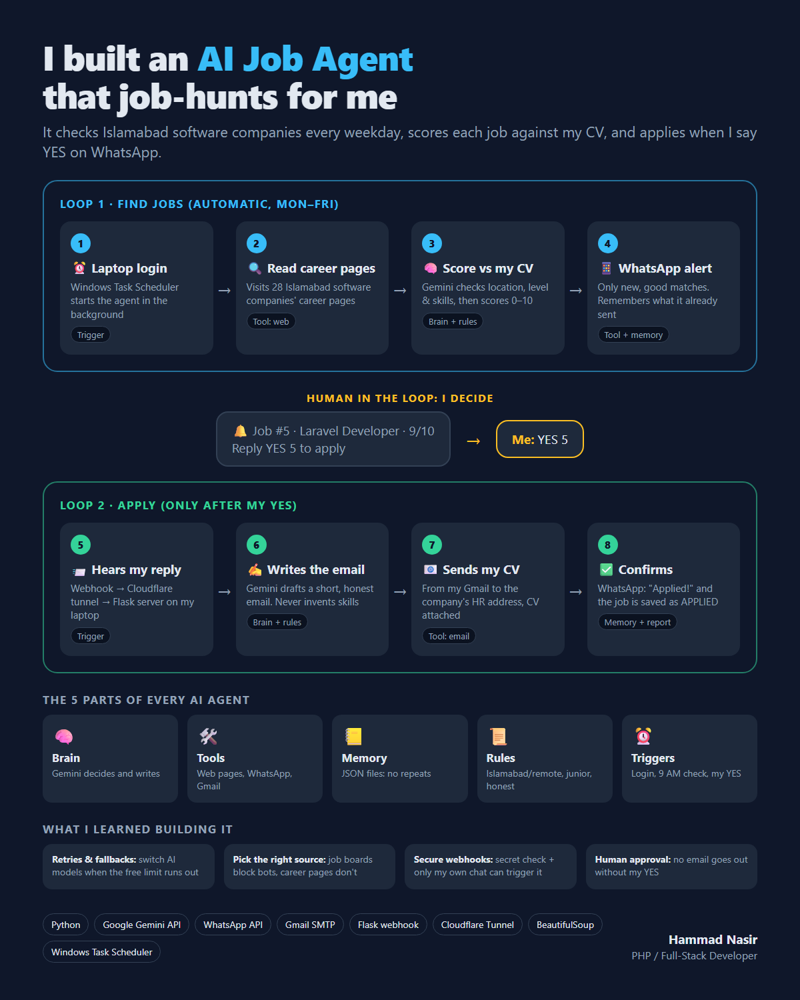

# AI Job Agent

An AI agent that job-hunts for me. Every weekday it checks the career pages of software companies in Islamabad, scores each job against my CV with Google Gemini, and sends good matches to my WhatsApp. When I reply **YES**, it writes an honest application email and sends my CV to the company's HR.



## How it works

**Loop 1: find jobs (automatic, Monday to Friday)**
1. I log in to my laptop. Windows Task Scheduler starts `auto_agent.py` in the background.
2. `check_companies.py` reads the career pages listed in `companies.json`.
3. Gemini compares each job with my CV and the rules in `my_profile.md` (location, level, skills) and gives a score from 0 to 10.
4. Good, new matches go to my WhatsApp: *"Job #5 · Laravel Developer · 9/10 · Reply YES 5"*.

**Human in the loop: I decide.** Nothing is sent without my reply.

**Loop 2: apply (only after my YES)**

5. WasenderAPI sends my WhatsApp reply to a webhook. A Cloudflare Tunnel connects it to a small Flask server on my laptop (`whatsapp_server.py`).
6. Gemini writes a short, honest email. It is told never to invent skills.
7. The email goes from my Gmail to the company's HR address, with my CV attached.
8. WhatsApp confirms: *"✅ Applied!"*

## The 5 parts of the agent

| Part | In this project |
|---|---|
| 🧠 Brain | Google Gemini (`ai.py`), with automatic fallback to other models when the free daily limit runs out |
| 🛠️ Tools | Read web pages (`jobs.py`), send WhatsApp (`send_whatsapp.py`), send email (`send_email.py`) |
| 📒 Memory | `seen_jobs.json` (no repeats) and `pending_jobs.json` (jobs waiting for my YES) |
| 📜 Rules | `my_profile.md` and the prompts (Islamabad or remote, junior level, never invent anything) |
| ⏰ Triggers | Laptop login, the daily 9 AM check, and my WhatsApp reply |

## Files

| File | What it does |
|---|---|
| `auto_agent.py` | Runs everything by itself (started by Task Scheduler) |
| `check_companies.py` | Checks company career pages for matching jobs |
| `companies.json` | The list of companies to check |
| `jobs.py` | Shared helpers: read a page, ask Gemini to find and score jobs, remember them |
| `match_job.py` | Score one job by hand: `python match_job.py job.txt` |
| `apply.py` | Apply from the terminal: `python apply.py 3` (shows the email first) |
| `whatsapp_server.py` | Listens for `YES 3` / `NO 3` on WhatsApp |
| `start_agent.py` / `start_agent.bat` | Starts the tunnel and the WhatsApp listener by hand |
| `send_whatsapp.py`, `send_email.py`, `ai.py` | WhatsApp, Gmail and Gemini |
| `find_jobs.py` | Older version that searched job boards (many block bots) |

## Setup

1. Install Python 3 and the libraries:
   ```
   pip install -r requirements.txt
   ```
2. Install [cloudflared](https://developers.cloudflare.com/cloudflare-one/connections/connect-networks/downloads/) (for the WhatsApp webhook).
3. Copy `.env.example` to `.env` and fill in your keys.
4. Copy `my_profile.example.md` to `my_profile.md` and describe yourself.
5. Edit `companies.json` with the companies you want to check.
6. Test the parts one by one:
   ```
   python match_job.py test_job.txt
   python send_whatsapp.py "Hello from my job agent"
   python send_email.py
   ```
7. Run it: double-click `start_agent.bat`, then run `python check_companies.py`.
8. Optional: add `auto_agent.py` to Windows Task Scheduler ("At log on", run with `pythonw.exe`) so it runs by itself.

## Notes

- **WhatsApp:** WasenderAPI is not an official WhatsApp product. It links your number like WhatsApp Web, and WhatsApp may block numbers that use unofficial tools. A spare number, or the official WhatsApp Business API (for example through Twilio), is safer.
- **Free limits:** the Gemini free plan has a small daily limit per model, so `ai.py` moves to the next model when one runs out.
- **Be polite to websites:** the agent reads each careers page once a day and skips sites that block bots.
- **Secrets:** `.env`, `my_profile.md` and the agent's memory files are in `.gitignore` and are never uploaded.

## Built with

Python · Google Gemini API · WasenderAPI (WhatsApp) · Gmail SMTP · Flask · Cloudflare Tunnel · BeautifulSoup · Windows Task Scheduler

I built this while learning agent development, with Claude Code as my pair programmer.
